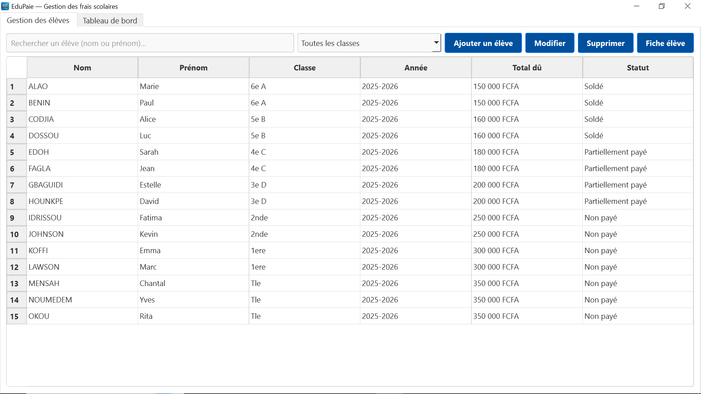
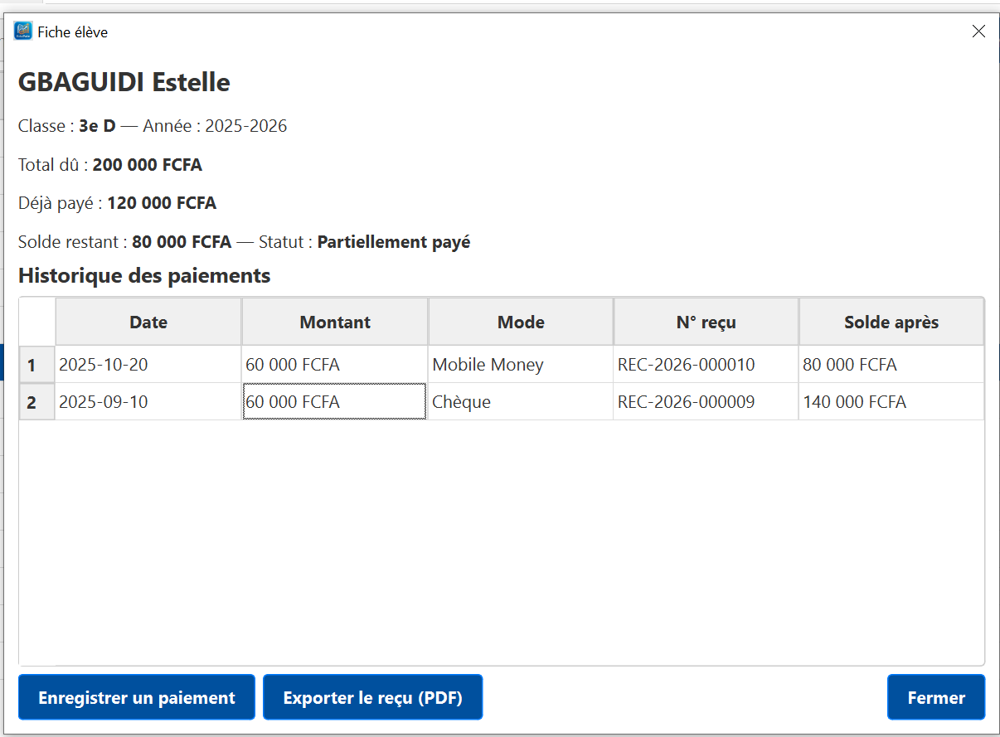
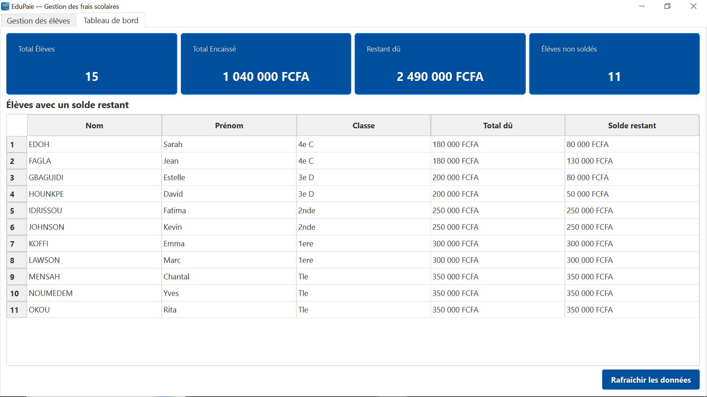
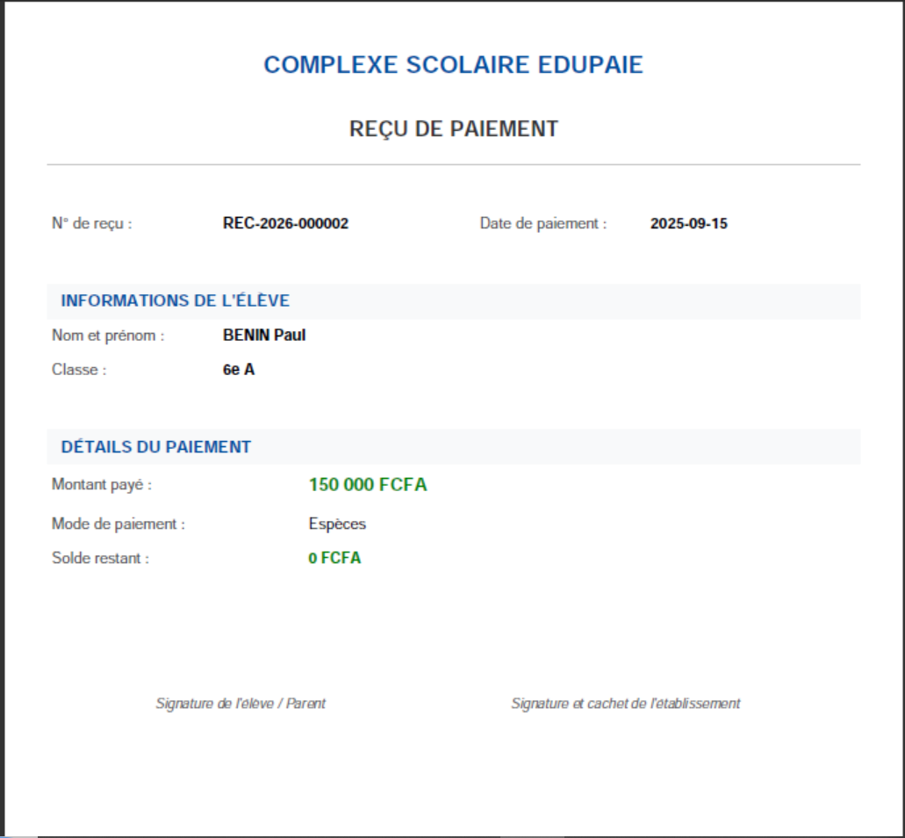

# Documentation Technique - EduPaie

## 1. Architecture retenue
L'application suit une architecture en 3 couches stricte (imposée par le cahier des charges) :
1. **Couche d'accès aux données (`database/` et `repositories/`)** : Gère la connexion SQLite et encapsule toutes les requêtes SQL. Aucun composant de l'interface ne fait de SQL directement.
2. **Couche métier (`services/`)** : Contient les règles de gestion (calcul du solde, validation du montant payé, génération du numéro de reçu unique).
3. **Couche interface (`ui/`)** : Développée avec PySide6. Elle gère l'affichage, les formulaires et les interactions avec l'utilisateur (Signaux/Slots).

Cette séparation permet de modifier l'interface sans toucher à la base de données, et inversement.

## 2. Choix techniques justifiés
- **PySide6** : Choisi car c'est la bibliothèque graphique officielle de Qt pour Python, moderne et robuste, imposée par le brief (excluant Tkinter et PyQt).
- **SQLite (`sqlite3`)** : Base de données légère, intégrée nativement à Python, ne nécessitant aucun serveur. Parfaite pour une application desktop mono-utilisateur.
- **Montants en `INTEGER`** : Le franc CFA n'ayant pas de centimes, stocker les montants sous forme de nombres entiers évite les erreurs d'arrondi liées aux nombres flottants (FLOAT).
- **fpdf2** : Bibliothèque légère et simple pour générer les reçus au format PDF, sans dépendances lourdes.
- **Snapshot du reçu** : La table `receipts` stocke une copie des informations de l'élève (nom, classe, solde après paiement) au moment du paiement. Cela garantit que la réimpression d'un reçu ancien sera toujours identique, même si l'élève change de classe plus tard.

## 3. Captures d'écran

- **Écran principal** : 
- **Fiche élève** : 
- **Tableau de bord** :
- **Reçu PDF** : 

## 4. Limites connues
- L'application est conçue pour un usage mono-poste (pas de gestion multi-utilisateurs simultanés en réseau).
- Il n'y a pas de système de sauvegarde automatique de la base de données (il est recommandé de copier le fichier `school.db` régulièrement).
- La modification du montant total dû est bloquée si elle devient inférieure à la somme des paiements déjà effectués (par mesure de sécurité).